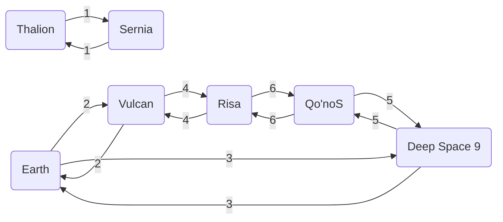

# Map Format

The map format consists of two sections:

1. The Timestamp (in 64bit [unix time](https://en.wikipedia.org/wiki/Unix_time))
2. The locations with their associated links

**Timestamp:**

```
 0                   1                   2                   3
 0 1 2 3 4 5 6 7 8 9 0 1 2 3 4 5 6 7 8 9 0 1 2 3 4 5 6 7 8 9 0 1
+-+-+-+-+-+-+-+-+-+-+-+-+-+-+-+-+-+-+-+-+-+-+-+-+-+-+-+-+-+-+-+-+
|                                                               |
+               Last Update (unix time) (int64_t)               +
|                                                               |
+-+-+-+-+-+-+-+-+-+-+-+-+-+-+-+-+-+-+-+-+-+-+-+-+-+-+-+-+-+-+-+-+
```

**Node:**

```
 0                   1                   2                   3  
 0 1 2 3 4 5 6 7 8 9 0 1 2 3 4 5 6 7 8 9 0 1 2 3 4 5 6 7 8 9 0 1
+-+-+-+-+-+-+-+-+-+-+-+-+-+-+-+-+-+-+-+-+-+-+-+-+-+-+-+-+-+-+-+-+
|          UID (uint16)         |        name_len (uint16)      |
+-+-+-+-+-+-+-+-+-+-+-+-+-+-+-+-+-+-+-+-+-+-+-+-+-+-+-+-+-+-+-+-+
| total_link_count (uint16)     |                               |
+-+-+-+-+-+-+-+-+-+-+-+-+-+-+-+-+                               +
|                    location Name (variable)                   |
+                                                               +
|                                                               |
+-+-+-+-+-+-+-+-+-+-+-+-+-+-+-+-+-+-+-+-+-+-+-+-+-+-+-+-+-+-+-+-+
|      link1 weight (uint16)    |      linked_uid1 (uint16)     |
+-+-+-+-+-+-+-+-+-+-+-+-+-+-+-+-+-+-+-+-+-+-+-+-+-+-+-+-+-+-+-+-+
|      link2 weight (uint16)    |      linked_uid2 (uint16)     |
+-+-+-+-+-+-+-+-+-+-+-+-+-+-+-+-+-+-+-+-+-+-+-+-+-+-+-+-+-+-+-+-+
|      link3 weight (uint16)    |      linked_uid3 (uint16)     |
+-+-+-+-+-+-+-+-+-+-+-+-+-+-+-+-+-+-+-+-+-+-+-+-+-+-+-+-+-+-+-+-+
|      linkN weight (uint16)    |      linked_uidN (uint16)     |
+-+-+-+-+-+-+-+-+-+-+-+-+-+-+-+-+-+-+-+-+-+-+-+-+-+-+-+-+-+-+-+-+
```
- The node fields will repeat for all the nodes in the map. You will be provided with a small and large example map.
- **UID** = Unique Identifier. There should never be two locations with the same UID.

## Example small map

The small example map contains 5 nodes. Their information is as follows:

| Node ID | Node Name    | Links (Weight, Destination ID) |
|---------|--------------|--------------------------------|
| 1       | Earth        | [(2, 2), (3, 3)]               |
| 2       | Vulcan       | [(2, 1), (4, 4)]               |
| 3       | Deep Space 9 | [(3, 1), (5, 5)]               |
| 4       | Risa         | [(4, 2), (6, 5)]               |
| 5       | Qo'noS       | [(5, 3), (6, 4)]               |

In this table:

- "Node ID" refers to the unique identifier for each location.
- "Node Name" is the name of the location.
- "Links" lists the connections from each node to others, with each tuple showing the weight of the link and the ID of the destination node.

It can also be viewed visualy in the following configuration:

