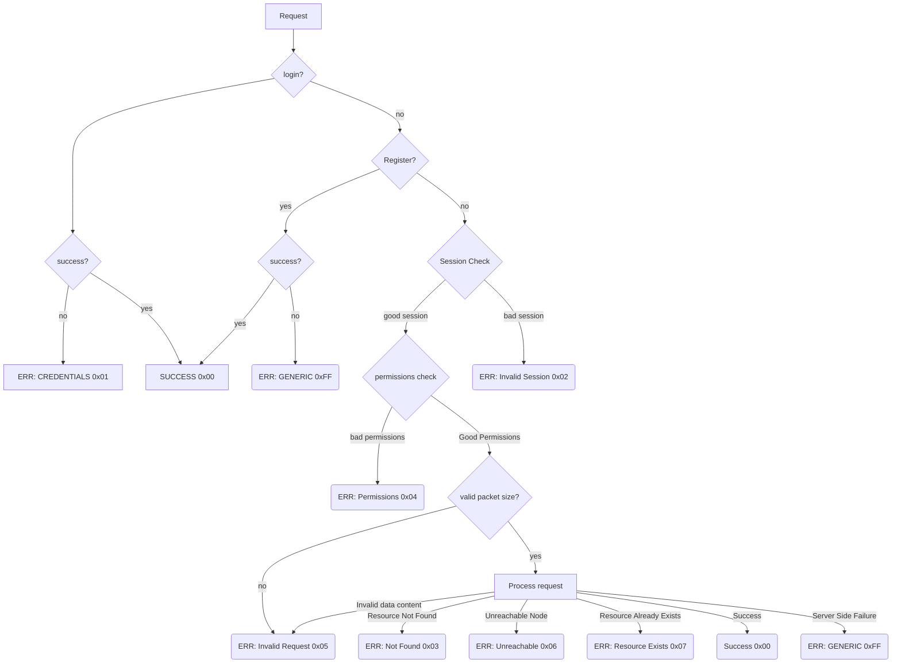

# Protocol

The `protocol` command to produce the graphics have been included in the protocol information below. Some fields are truncated or variable length, these fields can have a variable length, and the graphic will not match their actual size for the sake of brevity.

## Common Return Structure

| Return Code | Description                  | When it Occurs |
|-------------|------------------------------| ----- |
| 0x00        | Success                      | When a request is successful |
| 0x01        | Invalid Credentials          | When a login fails |
| 0x02        | Invalid Session ID           | Session ID in the request is invalid |
| 0x03        | Resource Not Found           | When a delete or modify action fails due to a resource not existing |
| 0x04        | Permissions Error            | a non-admin attempts an admin action |
| 0x05        | Invalid Request              | The request doesn't match the expected values |
| 0x06        | Unreachable                  | The requested node is unreachable |
| 0x07        | Resource Already Exists      | When an "add" action fails due to a location or user already existing |
| 0xFF        | Generic Error                | All other errors |

```raw
 0                   1                   2                   3  
 0 1 2 3 4 5 6 7 8 9 0 1 2 3 4 5 6 7 8 9 0 1 2 3 4 5 6 7 8 9 0 1
+-+-+-+-+-+-+-+-+-+-+-+-+-+-+-+-+-+-+-+-+-+-+-+-+-+-+-+-+-+-+-+-+
|Return (uint8_.|
+-+-+-+-+-+-+-+-+
```
- `protocol "Return (uint8_t):8"`

### Return Code Decision tree



## Op Codes:

| Command        | OP Code (Hex) |
|----------------|---------------|
| `login`        | 0x01          |
| `register`     | 0x02          |
| `admin_add`    | 0x03          |
| `user_del`     | 0x04          |
| `user_pass`    | 0x05          |
| `list`         | 0x06          |
| `search`       | 0x07          |
| `route`        | 0x08          |
| `link_add`     | 0x09          |
| `link_del`     | 0x0A          |
| `location_add` | 0x0B          |
| `location_del` | 0x0C          |

## Login

### Request

```raw
 0                   1                   2                   3  
 0 1 2 3 4 5 6 7 8 9 0 1 2 3 4 5 6 7 8 9 0 1 2 3 4 5 6 7 8 9 0 1
+-+-+-+-+-+-+-+-+-+-+-+-+-+-+-+-+-+-+-+-+-+-+-+-+-+-+-+-+-+-+-+-+
|OP Code (uint8.|              Padding (3x uint8_t)             |
+-+-+-+-+-+-+-+-+-+-+-+-+-+-+-+-+-+-+-+-+-+-+-+-+-+-+-+-+-+-+-+-+
|                      Padding (uint32_t)                       |
+-+-+-+-+-+-+-+-+-+-+-+-+-+-+-+-+-+-+-+-+-+-+-+-+-+-+-+-+-+-+-+-+
|   username length (uint16_t)  |   password length (uint16_t)  |
+-+-+-+-+-+-+-+-+-+-+-+-+-+-+-+-+-+-+-+-+-+-+-+-+-+-+-+-+-+-+-+-+
|                                                               |
+                                                               +
|                       Username (variable)                     |
+                                                               +
|                                                               |
+-+-+-+-+-+-+-+-+-+-+-+-+-+-+-+-+-+-+-+-+-+-+-+-+-+-+-+-+-+-+-+-+
|                                                               |
+                                                               +
|                       password (variable)                     |
+                                                               +
|                                                               |
+-+-+-+-+-+-+-+-+-+-+-+-+-+-+-+-+-+-+-+-+-+-+-+-+-+-+-+-+-+-+-+-+
```
- `protocol "OP Code (uint8_t):8, Padding (3x uint8_t):24, Session ID (uint32_t):32, username length (uint16_t):16, password length (uint16_t):16, Username (variable):96, password (variable):96"`

### Response

**On Success:**

```
 0 1 2 3 4 5 6 7 8 9 0 1 2 3 4 5 6 7 8 9 0 1 2 3 4 5 6 7 8 9 0 1
+-+-+-+-+-+-+-+-+-+-+-+-+-+-+-+-+-+-+-+-+-+-+-+-+-+-+-+-+-+-+-+-+
|Return Code (u.|              Session ID (uint32_t)            |
+-+-+-+-+-+-+-+-+-+-+-+-+-+-+-+-+-+-+-+-+-+-+-+-+-+-+-+-+-+-+-+-+
|               |
+-+-+-+-+-+-+-+-+
```

- `protocol "Return Code (uint8_t):8, Session ID (uint32_t):32"`

**On Error:**

- Single byte return packet with error code

## Register

### Request

- Same as [Login](#login)

### Response

- Single byte return packet with return code

## Add Admin

### Request

- Same as [Login](#login)

### Response

- Single byte return packet with return code

## User Delete

### Request

```
 0                   1                   2                   3  
 0 1 2 3 4 5 6 7 8 9 0 1 2 3 4 5 6 7 8 9 0 1 2 3 4 5 6 7 8 9 0 1
+-+-+-+-+-+-+-+-+-+-+-+-+-+-+-+-+-+-+-+-+-+-+-+-+-+-+-+-+-+-+-+-+
|OP Code (uint8.|              Padding (3x uint8_t)             |
+-+-+-+-+-+-+-+-+-+-+-+-+-+-+-+-+-+-+-+-+-+-+-+-+-+-+-+-+-+-+-+-+
|                      Session ID (uint32_t)                    |
+-+-+-+-+-+-+-+-+-+-+-+-+-+-+-+-+-+-+-+-+-+-+-+-+-+-+-+-+-+-+-+-+
|   username length (uint16_t)  |      padding (2x uint8_t)     |
+-+-+-+-+-+-+-+-+-+-+-+-+-+-+-+-+-+-+-+-+-+-+-+-+-+-+-+-+-+-+-+-+
|                                                               |
+                                                               +
|                       Username (variable)                     |
+                                                               +
|                                                               |
+-+-+-+-+-+-+-+-+-+-+-+-+-+-+-+-+-+-+-+-+-+-+-+-+-+-+-+-+-+-+-+-+

```
- `protocol "OP Code (uint8_t):8, Padding (3x uint8_t):24, Session ID (uint32_t):32, username length (uint16_t):16, padding (2x uint8_t):16, Username (variable):96"`

### Response

- Single byte return packet with return code

## User Password Change

### Request

```
 0                   1                   2                   3  
 0 1 2 3 4 5 6 7 8 9 0 1 2 3 4 5 6 7 8 9 0 1 2 3 4 5 6 7 8 9 0 1
+-+-+-+-+-+-+-+-+-+-+-+-+-+-+-+-+-+-+-+-+-+-+-+-+-+-+-+-+-+-+-+-+
|OP Code (uint8.|              Padding (3x uint8_t)             |
+-+-+-+-+-+-+-+-+-+-+-+-+-+-+-+-+-+-+-+-+-+-+-+-+-+-+-+-+-+-+-+-+
|                      Session ID (uint32_t)                    |
+-+-+-+-+-+-+-+-+-+-+-+-+-+-+-+-+-+-+-+-+-+-+-+-+-+-+-+-+-+-+-+-+
|   username length (uint16_t)  |   password length (uint16_t)  |
+-+-+-+-+-+-+-+-+-+-+-+-+-+-+-+-+-+-+-+-+-+-+-+-+-+-+-+-+-+-+-+-+
|                                                               |
+                                                               +
|                       Username (variable)                     |
+                                                               +
|                                                               |
+-+-+-+-+-+-+-+-+-+-+-+-+-+-+-+-+-+-+-+-+-+-+-+-+-+-+-+-+-+-+-+-+
|                                                               |
+                                                               +
|                       password (variable)                     |
+                                                               +
|                                                               |
+-+-+-+-+-+-+-+-+-+-+-+-+-+-+-+-+-+-+-+-+-+-+-+-+-+-+-+-+-+-+-+-+
```
- `protocol "OP Code (uint8_t):8, Padding (3x uint8_t):24, Session ID (uint32_t):32, username length (uint16_t):16, password length (uint16_t):16, Username (variable):96, new password (variable):96"`

### Response

- Single byte return packet with return code

## List

### Request

```
 0                   1                   2                   3  
 0 1 2 3 4 5 6 7 8 9 0 1 2 3 4 5 6 7 8 9 0 1 2 3 4 5 6 7 8 9 0 1
+-+-+-+-+-+-+-+-+-+-+-+-+-+-+-+-+-+-+-+-+-+-+-+-+-+-+-+-+-+-+-+-+
|OP Code (uint8.|              Padding (3x uint8_t)             |
+-+-+-+-+-+-+-+-+-+-+-+-+-+-+-+-+-+-+-+-+-+-+-+-+-+-+-+-+-+-+-+-+
|                      Session ID (uint32_t)                    |
+-+-+-+-+-+-+-+-+-+-+-+-+-+-+-+-+-+-+-+-+-+-+-+-+-+-+-+-+-+-+-+-+
| Location Name length (uint16_.|      padding (2x uint8_t)     |
+-+-+-+-+-+-+-+-+-+-+-+-+-+-+-+-+-+-+-+-+-+-+-+-+-+-+-+-+-+-+-+-+
|                                                               |
+                                                               +
|                    Location Name (variable)                   |
+                                                               +
|                                                               |
+-+-+-+-+-+-+-+-+-+-+-+-+-+-+-+-+-+-+-+-+-+-+-+-+-+-+-+-+-+-+-+-+
```

- `protocol "OP Code (uint8_t):8, Padding (3x uint8_t):24, Session ID (uint32_t):32, Location Name length (uint16_t):16, padding (2x uint8_t):16, Location Name (variable):96"`

### Response

**On Success:**

```
 0                   1                   2                   3  
 0 1 2 3 4 5 6 7 8 9 0 1 2 3 4 5 6 7 8 9 0 1 2 3 4 5 6 7 8 9 0 1
+-+-+-+-+-+-+-+-+-+-+-+-+-+-+-+-+-+-+-+-+-+-+-+-+-+-+-+-+-+-+-+-+
|Return (uint8_.|     Data Length (uint16_t)    |               |
+-+-+-+-+-+-+-+-+-+-+-+-+-+-+-+-+-+-+-+-+-+-+-+-+               +
|                                                               |
+                                                               +
|                         Data (variable)                       |
+                                                               +
|                                                               |
+-+-+-+-+-+-+-+-+-+-+-+-+-+-+-+-+-+-+-+-+-+-+-+-+-+-+-+-+-+-+-+-+
```
- `protocol "Return (uint8_t):8, Data Length (uint16_t):16, Data (variable):104"`
- Data field is null byte seperated. for example: `Earth\0Vulcan\0Andaria\0Tellar\0Omicron Theta`

**On Error:**

- Single byte packet with error code

## Search

### Request

```
 0                   1                   2                   3  
 0 1 2 3 4 5 6 7 8 9 0 1 2 3 4 5 6 7 8 9 0 1 2 3 4 5 6 7 8 9 0 1
+-+-+-+-+-+-+-+-+-+-+-+-+-+-+-+-+-+-+-+-+-+-+-+-+-+-+-+-+-+-+-+-+
|OP Code (uint8.|              Padding (3x uint8_t)             |
+-+-+-+-+-+-+-+-+-+-+-+-+-+-+-+-+-+-+-+-+-+-+-+-+-+-+-+-+-+-+-+-+
|                      Session ID (uint32_t)                    |
+-+-+-+-+-+-+-+-+-+-+-+-+-+-+-+-+-+-+-+-+-+-+-+-+-+-+-+-+-+-+-+-+
| Search String length (uint16_.|      Padding (2x uint8_t)     |
+-+-+-+-+-+-+-+-+-+-+-+-+-+-+-+-+-+-+-+-+-+-+-+-+-+-+-+-+-+-+-+-+
|                                                               |
+                                                               +
|                    Search String (variable)                   |
+                                                               +
|                                                               |
+-+-+-+-+-+-+-+-+-+-+-+-+-+-+-+-+-+-+-+-+-+-+-+-+-+-+-+-+-+-+-+-+
```

- `protocol "OP Code (uint8_t):8, Padding (3x uint8_t):24, Session ID (uint32_t):32, Search String length (uint16_t):16, padding (2x uint8_t):16, Search String (variable):96"`

### Response

- Same as [List](#list)

## Route

### Request

```
 0                   1                   2                   3  
 0 1 2 3 4 5 6 7 8 9 0 1 2 3 4 5 6 7 8 9 0 1 2 3 4 5 6 7 8 9 0 1
+-+-+-+-+-+-+-+-+-+-+-+-+-+-+-+-+-+-+-+-+-+-+-+-+-+-+-+-+-+-+-+-+
|OP Code (uint8.|              Padding (3x uint8_t)             |
+-+-+-+-+-+-+-+-+-+-+-+-+-+-+-+-+-+-+-+-+-+-+-+-+-+-+-+-+-+-+-+-+
|                      Session ID (uint32_t)                    |
+-+-+-+-+-+-+-+-+-+-+-+-+-+-+-+-+-+-+-+-+-+-+-+-+-+-+-+-+-+-+-+-+
|  Source name length (uint16_t)|  Dest. name length (uint16_t) |
+-+-+-+-+-+-+-+-+-+-+-+-+-+-+-+-+-+-+-+-+-+-+-+-+-+-+-+-+-+-+-+-+
|                                                               |
+                                                               +
|                     source name (variable)                    |
+                                                               +
|                                                               |
+-+-+-+-+-+-+-+-+-+-+-+-+-+-+-+-+-+-+-+-+-+-+-+-+-+-+-+-+-+-+-+-+
|                                                               |
+                                                               +
|                   destination name (variable)                 |
+                                                               +
|                                                               |
+-+-+-+-+-+-+-+-+-+-+-+-+-+-+-+-+-+-+-+-+-+-+-+-+-+-+-+-+-+-+-+-+
```
- `protocol "OP Code (uint8_t):8, Padding (3x uint8_t):24, Session ID (uint32_t):32, Source name length (uint16_t):16, Dest. name length (uint16_t):16, source name (variable):96, destination name (variable):96"`

### Response

```
 0                   1                   2                   3  
 0 1 2 3 4 5 6 7 8 9 0 1 2 3 4 5 6 7 8 9 0 1 2 3 4 5 6 7 8 9 0 1
+-+-+-+-+-+-+-+-+-+-+-+-+-+-+-+-+-+-+-+-+-+-+-+-+-+-+-+-+-+-+-+-+
|Return (uint8_.|     Data Length (uint16_t)    | Padding(uint8.|
+-+-+-+-+-+-+-+-+-+-+-+-+-+-+-+-+-+-+-+-+-+-+-+-+-+-+-+-+-+-+-+-+
|    Tot. Distance (uint16_t)   |                               |
+-+-+-+-+-+-+-+-+-+-+-+-+-+-+-+-+                               +
|                                                               |
+                                                               +
|                         Data (variable)                       |
+                                                               +
|                                                               |
+-+-+-+-+-+-+-+-+-+-+-+-+-+-+-+-+-+-+-+-+-+-+-+-+-+-+-+-+-+-+-+-+
```

- `protocol "Return (uint8_t):8, Data Length (uint16_t):16, Padding(uint8_t):8, Tot. Distance (uint16_t):16, Data (variable):112"`
- Data field should contain the start location, all the stops, and the destination seperated by a single null byte: `Start\0Stop1\0Stop2\0...StopN\0Destination`.
- For example: given the nodes `Earth -2-> Vulcan -4-> Orion -8-> Romulus` The trip length would be `14` and the data would be `Earth\0Vulcan\0Orion\0Romulus`
- A route with the same source and destination for example will always have trip length of `0` and the data would be `Start\0Destination`

## Add Link

### Request

```
 0                   1                   2                   3  
 0 1 2 3 4 5 6 7 8 9 0 1 2 3 4 5 6 7 8 9 0 1 2 3 4 5 6 7 8 9 0 1
+-+-+-+-+-+-+-+-+-+-+-+-+-+-+-+-+-+-+-+-+-+-+-+-+-+-+-+-+-+-+-+-+
|OP Code (uint8.|              Padding (3x uint8_t)             |
+-+-+-+-+-+-+-+-+-+-+-+-+-+-+-+-+-+-+-+-+-+-+-+-+-+-+-+-+-+-+-+-+
|                      Session ID (uint32_t)                    |
+-+-+-+-+-+-+-+-+-+-+-+-+-+-+-+-+-+-+-+-+-+-+-+-+-+-+-+-+-+-+-+-+
|  start name length (uint16_t) |   End name length (uint16_t)  |
+-+-+-+-+-+-+-+-+-+-+-+-+-+-+-+-+-+-+-+-+-+-+-+-+-+-+-+-+-+-+-+-+
|                                                               |
+                                                               +
|                 start location name (variable)                |
+                                                               +
|                                                               |
+-+-+-+-+-+-+-+-+-+-+-+-+-+-+-+-+-+-+-+-+-+-+-+-+-+-+-+-+-+-+-+-+
|                                                               |
+                                                               +
|                  end location name (variable)                 |
+                                                               +
|                                                               |
+-+-+-+-+-+-+-+-+-+-+-+-+-+-+-+-+-+-+-+-+-+-+-+-+-+-+-+-+-+-+-+-+
|        weight(uint16_t)       |
+-+-+-+-+-+-+-+-+-+-+-+-+-+-+-+-+
```

- `protocol "OP Code (uint8_t):8, Padding (3x uint8_t):24, Session ID (uint32_t):32, start name length (uint16_t):16, End name length (uint16_t):16, start location name (variable):96, end location name (variable):96, weight (uint16_t):16"`

### Response

- Single byte return packet with return code

## Delete Link

### Request

- same as [Add Link](#add-link)

### Response

- Single byte return packet with return code

## Add Location

### Request
```
 0                   1                   2                   3  
 0 1 2 3 4 5 6 7 8 9 0 1 2 3 4 5 6 7 8 9 0 1 2 3 4 5 6 7 8 9 0 1
+-+-+-+-+-+-+-+-+-+-+-+-+-+-+-+-+-+-+-+-+-+-+-+-+-+-+-+-+-+-+-+-+
|OP Code (uint8.|              Padding (3x uint8_t)             |
+-+-+-+-+-+-+-+-+-+-+-+-+-+-+-+-+-+-+-+-+-+-+-+-+-+-+-+-+-+-+-+-+
|                      Session ID (uint32_t)                    |
+-+-+-+-+-+-+-+-+-+-+-+-+-+-+-+-+-+-+-+-+-+-+-+-+-+-+-+-+-+-+-+-+
| Location Name length (uint16_.|      padding (2x uint8_t)     |
+-+-+-+-+-+-+-+-+-+-+-+-+-+-+-+-+-+-+-+-+-+-+-+-+-+-+-+-+-+-+-+-+
|                                                               |
+                                                               +
|                    Location Name (variable)                   |
+                                                               +
|                                                               |
+-+-+-+-+-+-+-+-+-+-+-+-+-+-+-+-+-+-+-+-+-+-+-+-+-+-+-+-+-+-+-+-+
```
- `protocol "OP Code (uint8_t):8, Padding (3x uint8_t):24, Session ID (uint32_t):32, Location Name length (uint16_t):16, padding (2x uint8_t):16, Location Name (variable):96"`

### Response

- Single byte return packet with return code

## Delete Location

### Request

```
 0                   1                   2                   3
 0 1 2 3 4 5 6 7 8 9 0 1 2 3 4 5 6 7 8 9 0 1 2 3 4 5 6 7 8 9 0 1
+-+-+-+-+-+-+-+-+-+-+-+-+-+-+-+-+-+-+-+-+-+-+-+-+-+-+-+-+-+-+-+-+
|OP Code (uint8.|                Padding (uint8_t)              |
+-+-+-+-+-+-+-+-+-+-+-+-+-+-+-+-+-+-+-+-+-+-+-+-+-+-+-+-+-+-+-+-+
|                      Session ID (uint32_t)                    |
+-+-+-+-+-+-+-+-+-+-+-+-+-+-+-+-+-+-+-+-+-+-+-+-+-+-+-+-+-+-+-+-+
| Location Name Length (uint16_.|             Padding           |
+-+-+-+-+-+-+-+-+-+-+-+-+-+-+-+-+-+-+-+-+-+-+-+-+-+-+-+-+-+-+-+-+
|                                                               |
+                                                               +
|                                                               |
+                     Location Name (variable)                  +
|                                                               |
+                                                               +
|                                                               |
+-+-+-+-+-+-+-+-+-+-+-+-+-+-+-+-+-+-+-+-+-+-+-+-+-+-+-+-+-+-+-+-+
```
- `protocol "OP Code (uint8_t):8, Padding (3x uint8_t):24, Session ID (uint32_t):32, Location Name length (uint16_t):16, padding (2x uint8_t):16, Location Name (variable):96"`

### Response

- Single byte return packet with return code